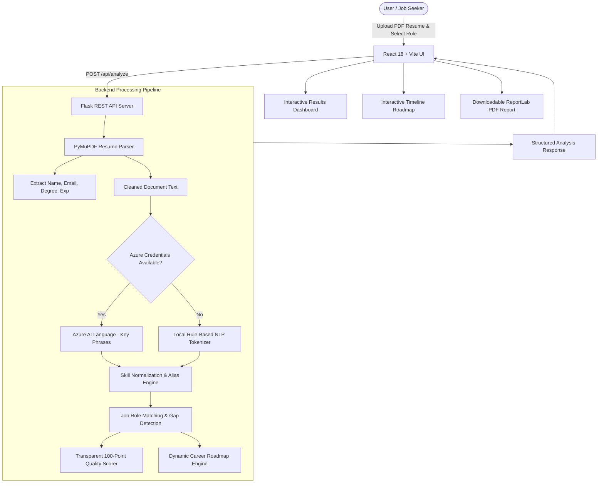

# AI Resume Analyzer & Career Advisor

> **Tagline:** Smart Resume Analysis and Personalized Career Guidance Using Azure AI.


---

## 📌 Executive Summary

**AI Resume Analyzer & Career Advisor** is a modern, enterprise-grade, full-stack web application tailored for college students, freshers, and job seekers. The platform ingests PDF resumes, extracts structured career profiles, identifies and normalizes technical and soft skills, transparently calculates a resume quality score out of 100, detects skill gaps against real industry roles, and generates dynamic week-by-week learning roadmaps with downloadable PDF reports.

The application features a **hybrid dual-engine architecture**:
1. **Cloud AI Mode:** Integrates Microsoft Azure AI Language (Text Analytics for Key Phrase Extraction), Azure AI Foundry (Generative AI Recommendations), and Azure Document Intelligence (OCR for scanned resumes).
2. **Local Fallback Engine:** Features built-in natural language tokenization, alias normalization, and rule-based scoring engines ensuring 100% functionality with zero downtime even without cloud credentials.

---

## 🎯 Key Capabilities & Features

- **Real PDF Text Extraction:** Powered by `PyMuPDF` with automatic section boundary identification, contact parsing, and candidate metadata extraction.
- **Azure AI Language Integration:** Directly extracts high-relevance key phrases and domain concepts using official Azure SDK client bindings.
- **Role Skill Matching:** Supports 5 high-demand engineering job tracks:
  1. *Full Stack Developer*
  2. *Python Developer*
  3. *Data Analyst*
  4. *AI/ML Engineer*
  5. *Java Developer*
- **Mathematical Match Percentage:** Computes strictly grounded compatibility metrics:  
  $$\text{Skill Match \%} = \left(\frac{\text{Matched Required Skills}}{\text{Total Required Skills}}\right) \times 100$$
- **Explainable Quality Scoring (100 Pts):** Transparent scoring across 6 essential categories:
  - Skills Relevance (30 pts)
  - Projects & Measurable Impact (20 pts)
  - Education & Academic Credentials (15 pts)
  - Professional Experience / Internships (15 pts)
  - Structure & Contact Formatting (10 pts)
  - Certifications & Competitive Coding (10 pts)
- **Personalized Career Roadmap:** Generates customized week-by-week timelines (e.g. Week 1-2, Week 3-4, Week 5-6, Week 7-8) strictly based on the candidate's actual missing skills, complete with curated documentation links and milestone capstone projects.
- **Downloadable Analysis PDF:** Produces publication-quality PDF reports generated dynamically via `ReportLab`.

---

## 🏗️ System Architecture



---

## 📂 Project Folder Structure

```
Resume Analyzer and Career Advisor/
├── frontend/
│   ├── public/
│   │   └── sample_resume.pdf
│   ├── src/
│   │   ├── components/
│   │   │   ├── Navbar.jsx             # Top branding, route navigation, Azure indicator
│   │   │   ├── Footer.jsx             # Tech badges, key features, slogan banner
│   │   │   ├── ResumeUpload.jsx       # Drag & drop upload, validation, sample button
│   │   │   ├── ScoreCard.jsx          # SVG animated circular progress indicators
│   │   │   ├── SkillChart.jsx         # Chart.js Donut & Category score bars
│   │   │   ├── SkillBadge.jsx         # Pill tags for matched, missing, preferred skills
│   │   │   └── LoadingAnimation.jsx   # Multi-stage AI scanning animation
│   │   ├── pages/
│   │   │   ├── Home.jsx               # SaaS landing page with 3D glowing resume card
│   │   │   ├── Analyzer.jsx           # Upload interface & job role selector
│   │   │   ├── Dashboard.jsx          # Results overview, scores, strengths, suggestions
│   │   │   ├── Roadmap.jsx            # Interactive timeline based on missing skills
│   │   │   └── About.jsx              # Project architecture & Azure engine docs
│   │   ├── services/
│   │   │   └── api.js                 # Axios API connector & report downloader
│   │   ├── App.jsx                    # Routing & state management
│   │   ├── main.jsx                   # React root entrypoint
│   │   └── index.css                  # Tailwind styles & animations
│   ├── package.json
│   ├── vite.config.js
│   └── tailwind.config.js
│
├── backend/
│   ├── app.py                         # Flask REST API endpoints & CORS
│   ├── resume_parser.py               # PyMuPDF vector extraction & metadata
│   ├── azure_ai.py                    # Azure AI Language SDK & fallback engine
│   ├── skill_matcher.py               # Skill normalizer & TF-IDF similarity
│   ├── scorer.py                      # Rule-based 100-point resume quality engine
│   ├── career_advisor.py              # Dynamic roadmap & project generator
│   ├── report_generator.py            # ReportLab PDF report builder
│   ├── create_sample_resume.py        # Generates test sample resume
│   ├── test_backend.py                # 7 automated unit tests
│   ├── sample_resume.pdf              # Pre-generated sample resume
│   ├── job_roles.json                 # Knowledge base of roles and skills
│   ├── requirements.txt               # Backend dependencies
│   ├── .env.example                   # Environment variable template
│   └── .env                           # Local environment configuration
│
├── README.md                          # Project documentation
├── PROJECT_DOCUMENTATION.md           # Formal academic project documentation
└── .gitignore                         # Version control exclusions
```

---

## 🛠️ Technology Stack

| Layer | Technologies |
| :--- | :--- |
| **Frontend** | React 18, Vite, Tailwind CSS, React Router DOM v6, Axios, Lucide React, Chart.js, React-Chartjs-2 |
| **Backend** | Python 3.14+, Flask 3.1, Flask-CORS, python-dotenv |
| **AI & NLP** | Microsoft Azure AI Language (`azure-ai-textanalytics`), Scikit-learn (TF-IDF & Cosine Similarity) |
| **Document Processing** | PyMuPDF (`fitz`), ReportLab 5.1 |

---

## ⚙️ Installation & Setup Instructions

### Prerequisites
- **Node.js:** v18 or later (v25+ supported)
- **Python:** v3.10 or later (v3.14 supported)
- **Git**

### 1. Backend Setup

```bash
# Navigate to the backend directory
cd backend

# Create a virtual environment
python -m venv venv

# Activate the virtual environment
# Windows (PowerShell):
.\venv\Scripts\Activate.ps1
# Linux / macOS:
# source venv/bin/activate

# Install dependencies
pip install -r requirements.txt

# Configure environment variables
# Copy .env.example to .env and optionally add your Azure keys
cp .env.example .env

# Run unit tests to verify installation
python test_backend.py

# Start the Flask API server
python app.py
```
Backend will start on `http://localhost:5000`.

### 2. Frontend Setup

In a new terminal window:

```bash
# Navigate to the frontend directory
cd frontend

# Install npm packages
npm install

# Start the Vite development server
npm run dev
```
Frontend will be accessible at `http://localhost:3000`.

---

## ☁️ Microsoft Azure AI Configuration

To enable Microsoft Azure AI cloud services, edit `backend/.env`:

```env
# Microsoft Azure AI Language (Text Analytics)
AZURE_LANGUAGE_ENDPOINT=https://<your-language-resource>.cognitiveservices.azure.com/
AZURE_LANGUAGE_KEY=<your-azure-language-api-key>

# Microsoft Azure AI Foundry (Optional: Generative Career Guidance)
AZURE_FOUNDRY_ENDPOINT=https://<your-foundry-resource>.openai.azure.com/
AZURE_FOUNDRY_KEY=<your-azure-foundry-key>
AZURE_FOUNDRY_DEPLOYMENT=<your-model-deployment-name>

# Microsoft Azure AI Document Intelligence (Optional: Scanned PDF OCR)
AZURE_DOCUMENT_ENDPOINT=https://<your-document-intelligence-resource>.cognitiveservices.azure.com/
AZURE_DOCUMENT_KEY=<your-document-intelligence-key>
```

> **Note on Fallback Mode:** If you do not provide Azure credentials, the platform automatically engages the **Local Fallback Engine**. All features (PDF parsing, skill detection, score calculation, roadmap generation, and report downloading) remain 100% operational without error.

---

## 📡 REST API Reference

| Method | Endpoint | Description | Request Payload | Response |
| :--- | :--- | :--- | :--- | :--- |
| `GET` | `/api/health` | Health & Azure connectivity check | None | `{ status, azure_status }` |
| `GET` | `/api/job-roles` | Get supported roles & required skills | None | `{ success, roles: [...] }` |
| `POST` | `/api/analyze` | Upload resume PDF & analyze against role | `multipart/form-data`: `resume` (PDF), `role` (string) | Full structured analysis JSON |
| `POST` | `/api/generate-roadmap` | Re-generate customized learning roadmap | JSON: `{ role, missing_skills, matched_skills }` | `{ success, roadmap: [...] }` |
| `POST` | `/api/download-report` | Generate downloadable PDF report | JSON: `analysisData` object | Binary PDF file (`application/pdf`) |

---

## 🛡️ Security & Privacy

1. **No Permanent Resume Storage:** Uploaded resumes are processed in memory and temporary files are strictly destroyed in a `try...finally` block immediately after extraction.
2. **Key Isolation:** All Azure keys and cloud credentials reside exclusively on the backend (`.env`). No secrets are ever leaked to client-side bundles.
3. **Upload Validation:** Rigorous inspection of MIME types, `.pdf` extension checks, non-empty validations, and strict 5 MB file size limit enforcement.

---

## 🔮 Future Scope

- Integration with LinkedIn API for real-time job posting matching.
- Multi-lingual resume analysis (Spanish, French, German, Hindi).
- Interactive mock technical interview simulator based on identified resume projects.
- GitHub repository automated code audit to verify claimed skills.

---

## 📄 License
This project is licensed under the MIT License.
